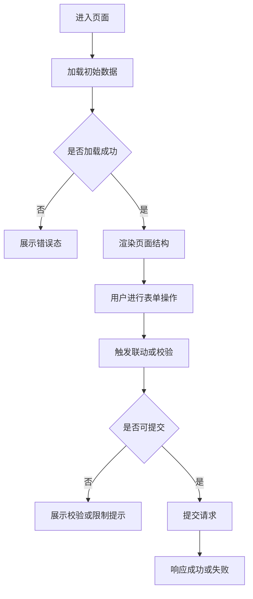

# 前端技术方案模板

> **版本**: v1.0
> **作者**: [填写姓名]
> **日期**: [YYYY-MM-DD]
> **关联需求/JIRA**: [JIRA单号，如 INFO-1234]
> **评审状态**: 待评审 / 评审中 / 已通过
> **常规设计使用工具和模型**: [如：Codex / gpt-5.4；Cursor / Claude；人工整理 / 不适用]

---

## 一、需求背景

### 1.1 所属系统

| 项目 | 说明 |
|------|------|
| 所属系统 | [如：库存管理系统 - 管理端；以当前需求为准] |
| 所属仓库 | [如：inventory-web] |
| 业务域 / 模块 | [如：交易录入 / 报价管理] |
| 当前技术栈 | [如：Vue / React + TypeScript + 当前项目表单库] |

### 1.2 所属功能入口

| 项目 | 说明 |
|------|------|
| 路由 | [如：`/trade/order/create`] |
| 页面名称 | [如：订单录入页] |
| 菜单 / tab / 上下文入口 | [如：库存 > 库存查询 > 筛选面板；填写路由、菜单或其他实际入口] |
| 是否多 tab / 弹窗 / 抽屉场景 | [如：是，多 tab 打开] |

### 1.3 需求背景与目标

- **问题描述**: [当前前端痛点、交互问题、字段问题或契约问题]
- **用户场景**: [谁在什么场景下使用，目标是什么]
- **本次目标**: [本次改动希望达成的用户目标和技术目标]
- **验收目标**: [如：录入链路闭环、字段展示一致、联动正确、不影响原有页面]
- **设计稿 / 原型 / 需求链接**: [链接地址]

### 1.4 需求边界与影响

| 项目 | 说明 |
|------|------|
| 包含范围 | [本次明确覆盖的页面、组件、交互、工具能力] |
| 不包含范围 | [本次明确不做的内容及原因] |
| 前提条件 | [如：后端接口已提供、类型定义待补齐] |
| 假设与约束 | [如：仅处理当前需求对应的业务链路，不做全局重构] |
| 是否影响已有功能 | [如：是，影响列表页筛选联动] |
| 兼容性要求 | [如：兼容旧页面参数透传方式] |
| 性能 / 体验要求 | [如：首屏不新增明显阻塞，联动响应 < 300ms] |

---

## 二、改动范围与牵涉范围

### 2.1 改动范围

| 类别 | 是否涉及 | 改动内容 | 代码路径 / 模块 |
|------|----------|----------|----------------|
| 业务布局组件 | [是/否] | [如：页面主布局、区域拆分、容器层编排] | [路径] |
| 业务专用组件 | [是/否] | [如：订单明细表单、业务弹窗] | [路径] |
| 业务通用组件 | [是/否] | [如：报价卡片、账户选择器] | [路径] |
| 通用 UI 组件 | [是/否] | [如：Modal、Table、Select 封装] | [路径] |
| 通用工具函数 | [是/否] | [如：字段格式化、金额转换、参数拼装] | [路径] |

### 2.2 牵涉范围

| 影响对象 | 影响内容 | 风险等级 | 回归关注点 |
|----------|----------|----------|------------|
| [如：当前页面相邻模块] | [如：筛选条件联动顺序变化] | [高/中/低] | [如：切换 tab 后状态恢复] |
| [如：共享组件调用方] | [如：props 语义变更] | [高/中/低] | [如：其他页面渲染是否受影响] |
| [如：上下游接口契约] | [如：字段新增 / 字段含义调整] | [高/中/低] | [如：请求与响应字段是否一致] |

**结论**: [明确说明本次是否影响其他模块；若影响，列出影响范围与规避方式]

### 2.3 复用评估与新增实现边界

| 能力类型 | 现有可复用能力 | 是否复用 | 结论说明 |
|----------|----------------|----------|----------|
| 组件能力 | [如：现有业务选择器组件] | [是/否] | [为何复用 / 为何不复用] |
| 表单 / 联动能力 | [如：现有表单配置及联动机制] | [是/否] | [为何复用 / 为何不复用] |
| 工具函数 / translator | [如：金额格式化 / DTO 转页面模型] | [是/否] | [为何复用 / 为何不复用] |

- **新增实现边界**: [若需要在当前模块内新增实现，请说明为什么不会继续复用现有公共能力]
- **代码注释要求**: [若新增实现偏离公共能力，需在哪些关键逻辑位置补充必要代码注释]

---

## 三、详细方案设计

### 3.1 页面结构与交互流程

- **页面结构说明**: [页面区域、容器职责、关键组件关系]
- **交互流程说明**: [关键前置条件、主操作路径、后续联动、异常态]

### 3.2 view / service / translator 分层落点

| 层级 | 职责 | 本次改动内容 | 说明 |
|------|------|--------------|------|
| view | [页面渲染、交互编排] | [内容] | [说明] |
| service | [接口调用、请求编排] | [内容] | [说明] |
| translator | [字段转换、页面模型与 DTO 映射] | [内容] | [说明] |

### 3.3 改动内容

| 改动点 | 类型 | 变动正文 | 关键注意事项 |
|--------|------|----------|--------------|
| [如：订单信息区重构] | [新增/修改/删除] | [说明具体变化] | [如：不改变原 props 契约] |
| [如：提交前参数拼装] | [新增/修改] | [说明具体变化] | [如：保持旧接口兼容] |

### 3.4 字段清洗、转换与前后端契约对齐（如适用）

| 字段 / 对象 | 页面展示值 | 表单值 / 状态值 | 请求字段 | 响应字段 | 提供方 | 消费方 | 转换规则 / 兼容策略 |
|-------------|------------|-----------------|----------|----------|--------|--------|---------------------|
| [字段名] | [说明] | [说明] | [说明] | [说明] | [前端/后端/中间层] | [view/service/translator] | [如：空值兜底、枚举映射、单位换算] |

- **字段来源说明**: [如：字段来自详情接口、字典接口、页面本地派生]
- **类型定义要求**: [如：前端类型、接口 DTO、枚举定义必须保持一致]
- **表单联动说明**: [如：选择 A 后清空 B；B 的可选值由 A 驱动]
- **不适用说明**: [若本次不涉及字段清洗、字段转换或前后端契约调整，请明确写“不适用”并说明原因]

### 3.5 状态管理、表单联动与异常态

| 场景 | 处理方式 | 说明 |
|------|----------|------|
| 初始加载 | [如：page-level loading] | [说明] |
| 表单联动 | [如：现有表单联动 / 局部 state] | [说明] |
| 空态 | [如：展示空列表或提示文案] | [说明] |
| 错误态 | [如：接口失败提示 + 可重试] | [说明] |
| 无权限态 | [如：按钮禁用 / 页面拦截] | [说明] |
| 提交中 / 防重 | [如：按钮 loading + 请求幂等] | [说明] |

---

## 四、实施安排与风险

### 4.1 实施步骤

| 步骤 | 对应需求 / 风险 | 实施动作 | 允许修改范围 | 验证方式 | 完成标准 |
|------|-----------------|----------|--------------|----------|----------|
| 1 | [需求/风险] | [实施动作] | [允许修改的模块或文件范围] | [验证方式] | [完成标准] |
| 2 | [需求/风险] | [实施动作] | [允许修改的模块或文件范围] | [验证方式] | [完成标准] |

### 4.2 风险与回滚

| 风险项 | 风险说明 | 预防措施 | 回滚或止损方式 |
|--------|----------|----------|----------------|
| [风险] | [说明] | [措施] | [方式] |

### 4.3 监控、埋点与兼容性（如适用）

| 类别 | 内容 | 说明 |
|------|------|------|
| 监控 | [如：接口错误率、前端异常日志] | [说明] |
| 埋点 | [如：关键按钮点击、提交结果] | [说明] |
| 兼容性 | [如：旧参数、旧页面调用方、浏览器约束] | [说明] |

---

## 五、验收与发布

### 5.1 验收方式

| 验收类型 | 工具 / 方式 | 验收内容 | 说明 |
|----------|-------------|----------|------|
| 页面交互验收 | [如：`chrome-devtools` / 手工冒烟] | [如：页面加载、联动、提交、异常态] | [说明] |
| 自动化辅助 | [如：现有脚本 / Playwright / 项目脚本] | [如：关键回归场景] | [说明] |
| 单元测试 | [如：Jest / Vitest / 项目现有框架] | [如：工具函数、translator] | [说明] |

### 5.2 验收用例

#### 交互联动场景

| 用例编号 | 场景 | 前置条件 | 操作步骤 | 预期结果 | 优先级 |
|---------|------|---------|---------|---------|--------|
| UI-001 | [如：主表单联动] | [说明] | [步骤] | [结果] | P0 |
| UI-002 | [如：提交后回填] | [说明] | [步骤] | [结果] | P0 |

#### 前后端通信与契约场景

| 用例编号 | 场景 | 校验重点 | 预期结果 | 优先级 |
|---------|------|----------|---------|--------|
| API-001 | [如：请求字段完整性] | [字段存在性、类型一致性、默认值] | [结果] | P0 |
| API-002 | [如：响应字段消费] | [提供方与消费方逻辑呼应] | [结果] | P0 |

#### 工具函数 / translator 场景（如适用）

| 用例编号 | 场景 | 输入 | 预期输出 | 说明 |
|---------|------|------|---------|------|
| UT-001 | [如：金额转换] | [输入] | [输出] | [说明] |

### 5.3 单元测试与自动化补充

- **单元测试要求**: [仅在当前项目既有测试框架下，为工具函数、translator 或非 trivial 分支补充必要单测]
- **不过度设计原则**: [只覆盖正常业务场景和关键边界，不为普通 UI 改动强行扩大量级]
- **自动化补充说明**: [若没有现成脚本，说明为什么当前仅采用 `chrome-devtools` 或手工冒烟]

### 5.4 发布与观察

| 步骤 | 操作 | 负责人 | 观察点 | 回滚点 |
|------|------|--------|--------|--------|
| 1 | [发布步骤] | [负责人] | [观察点] | [回滚点] |

---

## 附录

### A. 方案自检

| 自检问题 | 回答 |
|---------|------|
| 所属系统、功能入口、改动范围、牵涉范围是否完整？ | [回答] |
| 改动内容是否已追溯到需求与验收目标？ | [回答] |
| 字段清洗、转换与前后端契约是否闭环，或已明确不适用？ | [回答] |
| 是否已评估复用已有能力，避免重复造轮子？ | [回答] |
| 验收方式和验收用例是否足够覆盖关键交互与回归风险？ | [回答] |

### B. 评审记录

| 评审日期 | 参与人 | 评审工具 | 评审模型 | 评审结论 | 待解决事项 | 责任人 | 截止日期 |
|---------|--------|----------|----------|---------|-----------|--------|---------|
| [日期] | [人员列表] | [如：Codex MCP / Cursor CLI / Claude CLI / 本地 Subagent] | [如：gpt-5.4 / Claude Sonnet / 与常规设计不同；若无法不同需说明原因] | [通过/有条件通过/不通过] | [争议点] | [姓名] | [日期] |

### C. 参考资料

| 资料 | 链接 |
|------|------|
| [如：JIRA需求单] | [链接] |
| [如：设计稿] | [链接] |
| [如：接口文档] | [链接] |

### D. AI 实施约束与验证闭环

#### D.1 AI 实施原则

| 规则编号 | 原则 | 技术方案要求 | AI实施要求 |
|---------|------|--------------|------------|
| AI-001 | 显式假设与追问 | 影响范围、交互、字段、接口、验收、发布、回滚的未知点必须进入信息缺口或假设与约束 | 不得静默假设后直接实施 |
| AI-002 | 最小可行实现 | 优先选择满足当前需求的最小实现 | 不提前加入与需求无关的抽象或扩展点 |
| AI-003 | 变更可追溯 | 每个实现动作必须关联需求、验收目标或风险项 | 无法追溯的变更不得进入实施范围 |
| AI-004 | 外科手术式实施 | 明确允许修改的模块、文件或配置范围 | 不顺手重构无关模块 |
| AI-005 | 每步带验证 | 每个实施步骤必须有验证方式和完成标准 | 验证失败必须停止并反馈 |
| AI-006 | 先复现后修复 | Bug 修复类需求必须包含复现路径和失败用例 | 未复现的问题只能按假设推进，并在风险中标记 |

#### D.2 实施步骤与验证闭环

| 步骤 | 对应需求 / 风险 | 实施动作 | 允许修改范围 | 验证方式 | 完成标准 |
|------|-----------------|----------|--------------|----------|----------|
| 1 | [需求或风险] | [实施动作] | [允许修改范围] | [验证方式] | [完成标准] |
| 2 | [需求或风险] | [实施动作] | [允许修改范围] | [验证方式] | [完成标准] |
