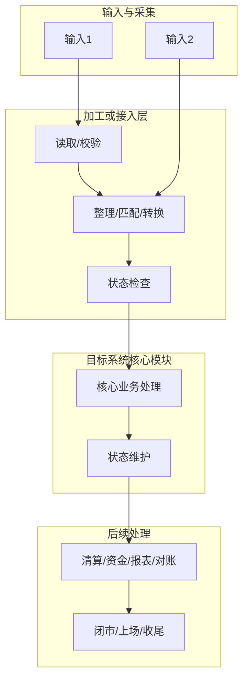

# 目标系统架构设计输出模板

本模板用于输出架构设计概要。不要为了套模板强行制造多套方案；只有在架构评估后确认存在真实不确定性，并且有两条或多条合理技术路线时，才展开多方案。若存在多方案，必须让每个方案都具备独立的“架构图 + 节点输入输出 + 边界说明 + 架构设计解读”。若需求只有一条合理路线，可保留单方案章节，并说明未展开多方案的原因。

## 目录

- [1. 设计结论与范围](#1-设计结论与范围)
- [2. 新增输入与基础规则](#2-新增输入与基础规则)
- [3. 系统整体加工链路](#3-系统整体加工链路)
- [4. 候选方案](#4-候选方案方案名称)
- [5. 独立模块或前置加工方案的可选补充图](#5-独立模块或前置加工方案的可选补充图)
- [6. 方案对比](#6-方案对比存在多方案时)
- [7. 关键改动点](#7-关键改动点)
- [8. 风险与待确认项](#8-风险与待确认项)
- [9. 建议推进顺序](#9-建议推进顺序)

关键技术概念第一次出现时，使用“直白中文理解（English original）”；若常见中文译法容易误解，再补充说明。不要只写英文术语，也不要为了通俗而删除英文原文。

## 1. 设计结论与范围

先用 3 到 6 句话给出结论摘要，再按以下要点补充必要信息：

- 本次设计目标。
- 本次链路起点和终点。
- 本次涉及的目标系统模块和外部系统。
- 本次只覆盖架构设计，不展开技术详细设计。
- 范围内和范围外事项。
- 推荐方向、备选方向和仍待确认事项。
- 是否存在多方案；如果存在，说明多方案产生的原因；如果不存在，说明只有单方案的约束原因。
- 本次最重要的 3 到 5 个架构问题，以及为什么它们决定边界、正确性或长期成本。
- 本次要控制的复杂性症状：多点修改（change amplification）、理解负担（cognitive load）和隐藏影响点（unknown unknowns）。

可补充一个结论表：

| 候选方案/方向 | 结论 | 适用前提 |
|---|---|---|
| [候选方案名称] |  |  |

补充核心设计问题表，避免结论退化成改动摘要：

| 核心设计问题 | 为什么重要 | 当前复杂性症状 | 本次控制目标 | 结论状态 |
|---|---|---|---|---|
|  |  | 多点修改 / 理解负担 / 隐藏影响点 |  | 已确认 / 推荐 / 推断 / 待确认 |

涉及存量实现时，补充代码与事实基线：

| 判断 | 证据类型 | 仓库 / Maven 模块 / 文件或配置 | 分支 / 提交号 / 核对日期 | 结论层级 |
|---|---|---|---|---|
|  | 代码 / 配置 / 正式文档 / 用户确认 |  |  | 已确认事实 / 代码支持判断 / 推断 / 待确认 |

不要把 Maven 模块、Java package、Spring 启动单元、部署单元和业务责任方合并成一个含糊的“所属模块”。

### 1.1 评审结论

先用三个问题复核设计：同一规则要改几处，调用者要理解多少内部信息，消费者、触发入口、状态、配置、权限和恢复路径能否全部找到。问题用于暴露成本，不要求机械得到“一处、很少、全部”的答案。

| 评审结论 | 已有结论或文档入口 | 责任方、依据或缺口 |
|---|---|---|
| 变更影响：消费者、入口、状态、配置、权限和遗漏 |  |  |
| 规则所有权：必须一致的不变量、口径及唯一维护者 |  |  |
| 行为契约：调用者可观察的输入、结果、错误及示例 |  |  |
| 恢复闭环：版本、消费范围、副作用处置和对账 |  |  |
| 演进验证：最小切片、兼容、观测、撤回与下一次变更验证 |  |  |

### 1.2 行为契约评估（涉及 TDD 或边界调整时）

| 调用方可观察行为 / 不变量 | 前置条件 | 预期结果或错误 | 候选契约与责任方 | 内部编排是否泄露 |
|---|---|---|---|---|
| 成功 / 重复 / 冲突 / 恢复 |  |  |  |  |

检查模拟组件、内部状态准备和调用顺序的负担，区分真实外部依赖与职责泄露，不以 mock 数量机械定论。以行为示例修正候选边界；实现阶段的测试允许内部实现变化，不锁定私有顺序。

## 2. 新增输入与基础规则

### 2.1 新增输入清单

| 输入 | 业务来源 | 目标系统直接采集来源 | 中转平台 | 到达/触发时点 | 进入目标系统后用途 | 口径及其维护者 | 共同约束 |
|---|---|---|---|---|---|---|---|
|  |  |  |  |  |  |  |  |

要求：

- 区分业务来源和目标系统直接采集来源。
- 写清外部系统、平台、内部模块或数据库的输入输出边界。
- 写清数据到达时点、批次、版本、补采和重跑口径。

### 2.2 基础业务规则

用表格或短段落说明：

- 账户、机构、业务方案、交易日、清算日等公共口径。
- 匹配规则、金额处理规则、枚举或状态转换规则。
- 哪些规则已确认，哪些需要生产样例或技术同事进一步确认。
- 每项关键规则由哪个模块唯一维护；消费者实际需要哪些结果、状态和错误，哪些内部处理细节不应暴露。
- 每个默认值由技术保护规则、产品需求还是权威上下文决定；包括技术保护值在内，只要会截断数据、改变业务结果或业务时效，就进入需求确认；权限始终服从授权策略。

## 3. 系统整体加工链路

本章只写跨方案共用的总体时序和共同输入口径。不要把所有方案的详细节点输入输出都塞在这里。

### 3.1 总体时序流程

说明：

1. 输入如何产生。
2. 数据如何进入目标系统或独立模块。
3. 哪些模块加工和消费。
4. 核心业务结果在哪里产生和维护。
5. 如何进入闭市、上场、对账或其他收尾动作。

### 3.2 共同数据输入说明

| 输入 | 来源和到达时点 | 进入目标系统后的用途 | 共同约束 |
|---|---|---|---|
|  |  |  |  |

### 3.3 数据质量监控备忘

| 监控主题 | 检查对象 | 检查口径 | 处理建议 |
|---|---|---|---|
| 输入缺失 |  |  |  |
| 关键字段缺失 |  |  |  |
| 版本或读取标记异常 |  |  |  |
| 匹配失败 |  |  |  |
| 金额或数量不一致 |  |  |  |
| 核心结果缺失 |  |  |  |
| 上场/通知/对账异常 |  |  |  |

监控规则未完全明确时，也应先作为备忘项保留，后续再固化成告警阈值、阻断等级和运营处理入口。

### 3.4 复杂性热点与知识所有权

| 热点/关键知识 | 当前责任方 | 需要理解或修改的参与方 | 复杂性症状 | 设计处理 |
|---|---|---|---|---|
|  |  |  | 多点修改 / 理解负担 / 隐藏影响点 | 消除 / 集中封装 / 保留并显式管理 |

重点标记同一规则多处实现、隐式时序、重复状态、跨层透传和只能依赖经验发现的影响点。该表用于定位架构问题，不替代节点输入输出表。

### 3.5 关键架构决定与依据

只记录真正影响边界、正确性或长期成本的决定，避免把普通实现选择都升级为架构决定。

| 关键决定 | 为什么重要 | 结论与理由 | 快速排除的候选及原因 | 必须保持不变的规则和接口约定 | 规则维护者 | 事实依据或相关入口 |
|---|---|---|---|---|---|---|
|  |  |  |  |  |  |  |

## 4. 候选方案：[方案名称]

本章是可重复区块：单方案保留一次；存在多条合理路线时，为每个候选复制一份并分别完整填写。不要把只做了快速排除的路线扩写成完整方案。

### 4.1 候选方案架构图

### 4.2 候选方案节点输入输出与现有机制参考

| 节点 | 输入 | 输出及固定含义 | 仓库 / 构建模块 / 运行单元 / 业务责任方 | 调用方不需要了解的内部处理 | 可借鉴机制或现有参考 | 说明 |
|---|---|---|---|---|---|---|
|  |  |  |  |  |  |  |

说明要求：

- 每个节点必须有具体输入和输出。
- 现有机制只作为参考，不默认复用。
- 如建议复用或扩展现有机制，必须写明理由和影响。
- 常见调用方不应理解内部存储、状态映射和恢复步骤；若必须理解，要说明原因和风险。

### 4.3 候选方案收尾接入方式

| 阶段 | 检查内容 | 处理方式 |
|---|---|---|
| 数据到齐 |  |  |
| 加工完成 |  |  |
| 核心处理完成 |  |  |
| 后续处理完成 |  |  |
| 上场/对账/闭市准备 |  |  |

说明闭市、上场、对账等收尾流程是状态接入还是现场加工。对于大批量明细，优先在收尾流程前完成加工。

## 5. 独立模块或前置加工方案的可选补充图

仅当某个候选引入独立模块、合作开发、黑盒处理或前置加工边界时，才在该候选方案中选用本章图表。不要把本章当成默认的“方案二”，也不要把所有职责塞进一张图。

### 5.1 输入同步图

### 5.2 结果进入核心链路图

### 5.3 查询与控制边界图

### 5.4 独立模块或前置加工节点输入输出与现有机制参考

| 节点 | 输入 | 输出及固定含义 | 仓库 / 构建模块 / 运行单元 / 业务责任方 | 调用方不需要了解的内部处理 | 可借鉴机制或现有参考 | 说明 |
|---|---|---|---|---|---|---|
| 数据生产侧输入 |  |  |  |  |  |  |
| 输入同步 |  |  |  |  |  |  |
| 原始数据加工 |  |  |  |  |  |  |
| 预处理结果生成 |  |  |  |  |  |  |
| 预处理结果同步 |  |  |  |  |  |  |
| 服务 API 查询/控制 |  |  |  |  |  |  |
| 核心模块消费结果 |  |  |  |  |  |  |
| 后续模块处理 |  |  |  |  |  |  |
| 收尾流程 |  |  |  |  |  |  |

### 5.5 数据流、读标与回退重跑

| 场景 | 推荐处理方式 | 读标/批次要求 | 回退或重跑口径 |
|---|---|---|---|
| 首次消费 |  |  |  |
| 重复消费 |  |  |  |
| 数据修改 |  |  |  |
| 前置加工错误 |  |  |  |
| 核心处理失败 |  |  |  |
| 上游补采 |  |  |  |

要求：

- 大批量结果优先同步到消费侧本地快照。
- 说明 API 的查询、控制及批量传输边界；对大批量链路给出容量、时效、一致性和失败恢复证据。
- 新版本不得直接覆盖已被核心流程锁定的旧版本。
- 核心侧回退和前置加工侧回退要写清先后关系。

## 通用恢复约束（适用于所有方案）

| 输入版本 / 规则版本 / 旧结果 | 已发布或消费范围及责任方 | 新结果版本及关联 | 可逆回退 / 不可逆补偿 | 检查点、重试幂等与最终对账 |
|---|---|---|---|---|
|  |  |  |  |  |

只有未发布且未消费的临时结果才可按明确策略覆盖。先固定输入、规则与结果版本并核实副作用；可逆状态由责任模块回退，不可逆副作用生成可审计的补偿；处置明确后再从检查点继续，无法安全处置时阻断并转人工。不能覆盖已发布或已消费结果，也不能重放全部原业务。补采还需记录来源标识、原业务时间、应到/实到时间、补采批次、去重和重开收尾条件。

## 6. 方案对比（存在多方案时）

只有存在两条或多条合理候选时才保留本章；单方案情况下删除本章，并在结论中说明其他路线被快速排除的约束。

| 维度 | 候选方案 A | 候选方案 B |
|---|---|---|
| 数据加工位置 |  |  |
| 核心模块改动范围 |  |  |
| 上下游交互方式 |  |  |
| 数据一致性设计 |  |  |
| 回退重跑复杂度 |  |  |
| 闭市/上场/对账接入 |  |  |
| 外部协作可见性 |  |  |
| 后续扩展性 |  |  |
| 多点修改（change amplification）：相邻需求需修改的位置 |  |  |
| 理解负担（cognitive load）：正确修改需掌握的上下文 |  |  |
| 隐藏影响点（unknown unknowns）：是否存在事前难以发现的遗漏 |  |  |
| 设计知识封装（information hiding）与接口收益 |  |  |
| 特殊情况与调用方复杂性 |  |  |
| 主要风险 |  |  |

比较结论还要说明每个方案消除、集中封装、保留和转嫁了哪些复杂性。不能只按改动文件数、服务数或短期工期选择方案。

## 7. 关键改动点

| 模块/系统 | 改动点 | 解决的架构问题/复杂性 | 对存量行为的影响 |
|---|---|---|---|
|  |  |  |  |

按外部系统、平台、目标系统模块、独立模块、监控/运营等维度列出。

## 8. 风险与待确认项

| 风险/待确认项 | 说明 |
|---|---|
| 技术模式选择 |  |
| 输入契约 |  |
| 默认值依据与权限边界（涉及默认值时） |  |
| 数据覆盖 |  |
| 匹配或关联键 |  |
| 数据隔离与同步 |  |
| 核心业务类型和状态 |  |
| 收尾流程边界 |  |
| 数据质量监控 |  |
| 规则由谁维护、是否在多处重复 |  |
| 隐式依赖或未知影响点 |  |
| 后续扩展差异 |  |
| 性能目标、容量假设或现状基线、验证计划/复测与撤回条件（涉及性能时） |  |

## 9. 建议推进顺序

1. 确认最重要的架构问题、复杂性控制目标和技术模式。
2. 确认每项关键规则由谁维护以及模块如何划分，优先解决会造成多点修改或隐式依赖的决定。
3. 确认输入契约、直接采集源头、批次/版本和补采机制。
4. 确认基础规则、匹配口径和仍待生产样例验证的规则。
5. 定义原始数据、标准数据、加工结果、核心消费状态之间的分层关系。
6. 确认跨模块数据同步方式和读取标记。
7. 对齐核心业务结果、收尾流程和回退重跑路径。
8. 补齐监控备忘项并明确后续落地规则。
9. 回填第 1 章评审结论，并将架构结论交给详细技术方案、Wiki 或实施文档阶段继续展开。

### 9.1 存量系统的渐进演进

| 近期真实变更及痛点 | 最小可验证切片 | 旧契约兼容期 / 唯一写入方 | 观测与切换条件 | 撤回及状态恢复条件 | 下一次真实变更如何验证收益 |
|---|---|---|---|---|---|
|  |  |  |  |  |  |

先验证切片的正确性和恢复能力，再用下一次相邻需求比较修改位置、理解负担和遗漏，证据充分后扩大范围。切流开关不等于数据与副作用可回退。没有历史证据时列出假设及补验安排；不涉及迁移则说明不适用。

本模板中的检查项按需求风险选择，不代表目标系统团队已经把所有做法固化为统一规范。若要增加长期检查项，先在真实需求中试用并记录收益与维护成本。
